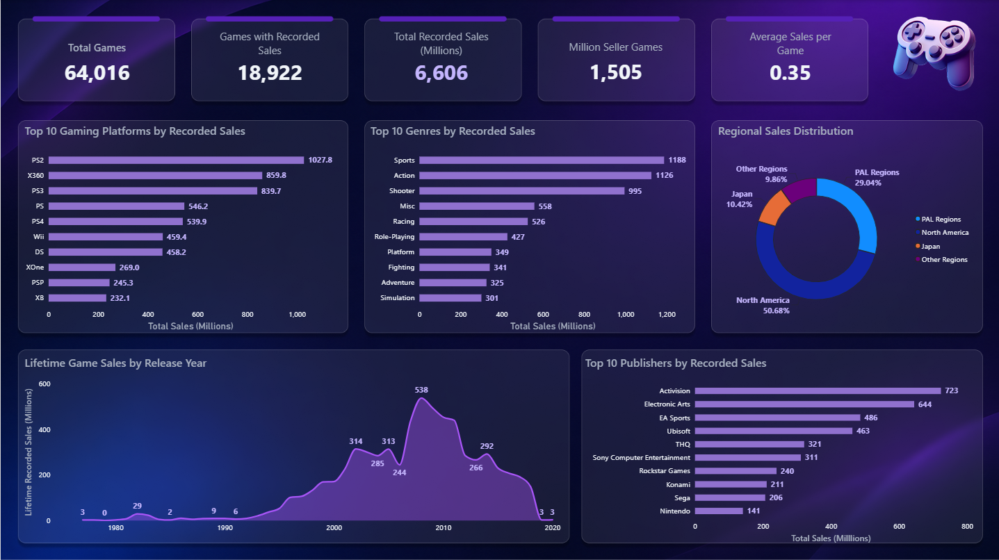

# 🎮 Video Game Sales Analytics

An interactive Power BI project exploring global video game sales across gaming platforms, genres, publishers, and developers.

## 📌 Project Overview

This project analyzes video game sales data to identify sales patterns, platform performance, genre popularity, and publisher performance. The objective is to transform raw data into meaningful insights through data cleaning, exploratory analysis, DAX calculations, and interactive Power BI dashboards.

## 🎯 Business Objectives

- Identify the gaming platforms with the highest recorded sales.
- Analyze sales performance across different game genres.
- Understand regional sales distribution.
- Evaluate publisher and developer performance.
- Examine relationships between game library size and sales efficiency.
- Explore historical sales patterns by game release year.

## 🛠️ Tools & Technologies

- **Power BI** – Interactive dashboards and data visualization.
- **Power Query** – Data cleaning and transformation.
- **DAX** – Measures and analytical calculations.
- **Google Sheets / Excel** – Data preparation and validation.

## 📊 Dataset

- **Source:** VGChartz Video Game Sales Dataset
- **Records:** 64,016 games
- **Attributes:** 14 columns
- **Coverage:** Historical game releases from 1971 to 2024.

The dataset includes game titles, platforms, genres, publishers, developers, critic scores, regional sales, total sales, and release dates.

## 📈 Dashboard Pages

### 1. Executive Overview

Provides a high-level summary of overall sales performance, including key metrics, top-performing platforms, genres, publishers, regional distribution, and historical sales patterns.

### 2. Platform Performance

Evaluates platform performance through recorded sales, game counts, average sales per game, historical platform trends, and sales efficiency.

### 3. Genre Analysis

Explores genre-level sales performance, average sales per game, game library size, and the relationship between genre scale and sales efficiency.

### 4. Publisher & Developer Analysis

Examines leading publishers and developers by recorded sales, publisher sales efficiency, and the relationship between publisher scale and sales performance.

## 🔑 Key Performance Indicators

| KPI | Result |
|---|---:|
| Total Games | 64,016 |
| Games with Recorded Sales | 18,922 |
| Total Recorded Sales | 6,605.91 million |
| Million-Seller Games | 1,505 |
| Average Sales per Game | 0.35 million |

## 💡 Key Findings

- PlayStation 2 leads the platform rankings with approximately 1,027.76 million in recorded sales.
- Sports is the highest-selling genre, followed by Action and Shooter.
- North America contributes approximately 50.68% of recorded regional sales.
- Activision leads the publisher rankings by cumulative recorded sales.
- Rockstar Games has the highest average sales per game among the selected top 10 publishers.
- Approximately 67.83% of recorded sales comes from game records with at least one million in sales.

## ⚙️ Analytical Approach

1. Inspected the original dataset and assessed missing values and data quality.
2. Cleaned text fields and standardized categorical values.
3. Preserved missing sales values rather than treating them as zero.
4. Built analytical measures using DAX.
5. Developed interactive dashboards with rankings, trend analysis, KPI cards, and scatter charts.
6. Validated sales aggregations across platforms, genres, and publishers.

## ⚠️ Data Limitations

- Sales figures are recorded in millions.
- Sales information is unavailable for many game records.
- Missing sales values should not be interpreted as zero sales.
- Historical sales grouped by release year represent lifetime recorded sales of games released in that year, not actual annual industry revenue.
- Results reflect the available dataset and should be interpreted within its reporting limitations.

## 👨‍💻 Author

**Shreyas**

Aspiring Data Analyst

[GitHub](https://github.com/shreyas141607)
